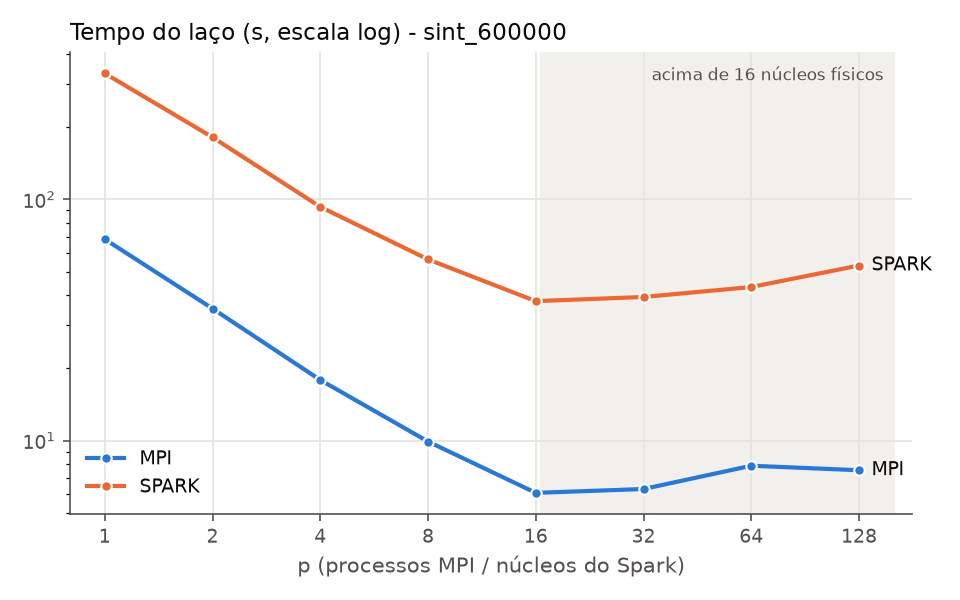
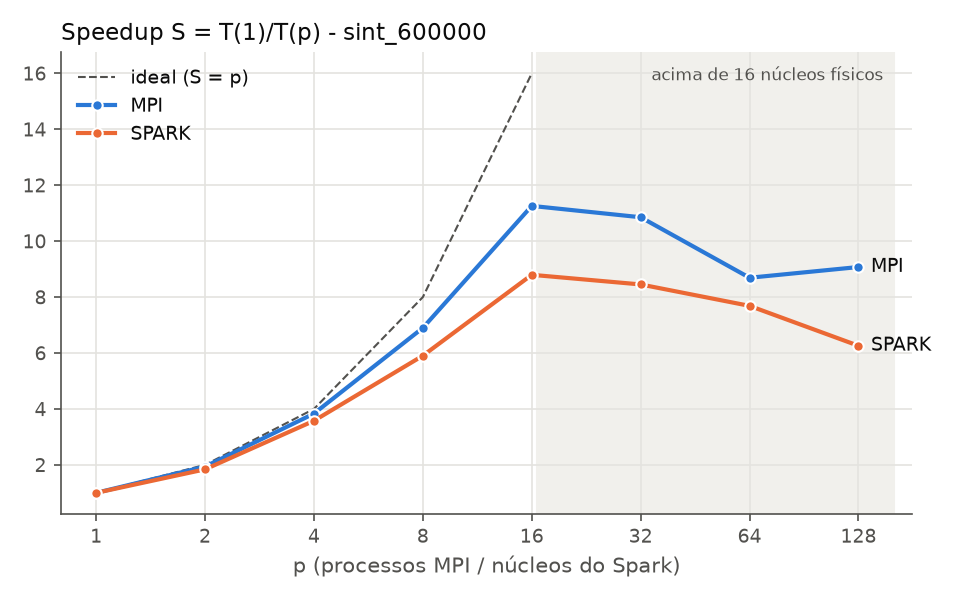
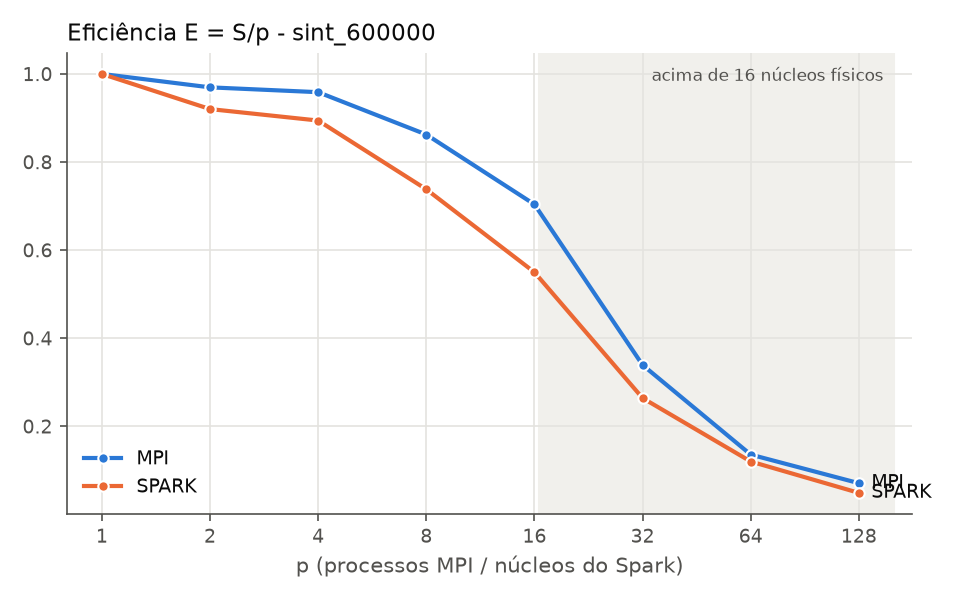
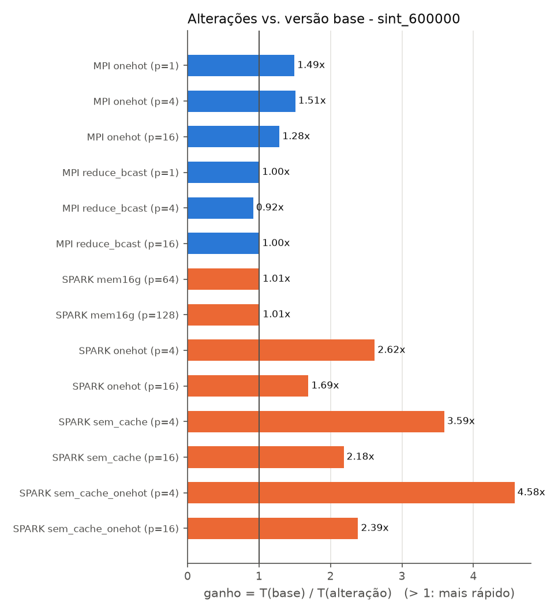

# Trabalho 2: K-Means em MPI × Spark

Agrupamento de documentos (vetores numéricos N × d) com o K-Means de Lloyd, implementado em **Python + MPI (mpi4py)** e em **PySpark (RDD)**, executado no cluster da disciplina e comparado seguindo a metodologia de Saxena et al. (2020), *Comparison of MPI and Spark for Data Science Applications*.

**Resumo dos resultados** (N = 600 mil, d = 256, k = 64, 20 iterações, 1 nó com 16 núcleos físicos):

- **MPI:** speedup de **11,3** com 16 processos (eficiência de 70%).
- **Spark:** speedup de **8,8** com 16 núcleos (eficiência de 55%).
- **O Spark foi de 4,9× a 6,2× mais lento que o MPI** com o mesmo número de núcleos.
- **Os dois param de ganhar a partir de 16:** é o número de núcleos físicos do nó.
- **Validação:** as **115 execuções** (sequencial, MPI, Spark e todas as variantes) terminaram com a **mesma inércia**, 88192.307179.

---

## 1. Aplicação e dados

- **Algoritmo:** K-Means de Lloyd com **número fixo de iterações (20)**, para que todas as versões façam exatamente o mesmo trabalho. Os centroides iniciais `C0` são sorteados com semente fixa e salvos em arquivo, então as três versões partem do mesmo ponto.
- **Atribuição:** é a etapa cara, O(N·k·d) por iteração. A distância é vetorizada com ‖x − c‖² = ‖x‖² − 2x·c + ‖c‖², em que o termo `X @ C.T` é um produto de matrizes (BLAS).
- **Atualização:** usa **somas e contagens** por cluster e só divide no fim. "Média de médias" estaria errada com grupos de tamanhos diferentes.
- **Cluster vazio:** mantém o centroide anterior.
- **Dados (`gera_dados.py`):**
  - k "temas" não negativos mais ruído, com cada linha normalizada para norma 1. Com norma 1, a distância euclidiana equivale ao cosseno, a medida usual para textos.
  - Matriz **densa, float64 e contígua**, salva em `.npy`. Os buffers das primitivas MPI em maiúscula exigem isso.
  - A geração é feita **uma única vez, fora das medições**. As três versões leem o mesmo arquivo.
  - No cluster, os dados foram gerados no próprio nó e conferidos pelas somas de X e de C0. Por exemplo, `sint_20000`: soma(X) = 226919.462829, soma(C0) = 722.818748.
- **Validação com texto real:** durante o desenvolvimento, as versões também foram validadas com o **20 Newsgroups** (TF-IDF com 20 mil termos → TruncatedSVD com d = 256 → norma 1; N = 18.278, k = 20). A inércia foi idêntica nas três versões, com max |C − C_seq| ≤ 5,6e-16. Esse modo foi removido do `gera_dados.py` para simplificar o código; a validação está registrada no commit `88d92bc`.

## 2. Implementação MPI (`kmeans_mpi.py`): primitivas e buffers

Usamos só as **variantes em maiúscula** (buffers numpy, sem pickle). Os tamanhos abaixo são para N = 600 mil, d = 256, k = 64:

| Primitiva | Dados | Tamanho | Quando |
|---|---|---|---|
| `Bcast` | dimensões N, d, k | 3 × int64 | 1× |
| **`Scatterv`** | linhas de X (N não precisa ser divisível por p) | N·d·8 = **1,23 GB** no total | 1× (`t_dist`) |
| **`Bcast`** | centroides iniciais C0 | k·d·8 = **128 KB** | 1× (`t_dist`) |
| **`Allreduce` (SUM)** | somas por cluster | k·d·8 = **128 KB** | **a cada iteração** |
| **`Allreduce` (SUM)** | contagens por cluster | k·8 = 512 B | a cada iteração |
| `Reduce` (MAX / SUM) | tempos / inércia | 4 e 1 doubles | 1×, fora do tempo |
| `Barrier` | delimita o cronômetro | — | — |

- **`Scatterv`:** os primeiros `N % p` processos recebem uma linha a mais. Os `counts` e `displs` são passados em **elementos** (linhas × d).
- **Depois do `Allreduce`, todos os processos têm as somas globais** e calculam os mesmos novos centroides. Por isso não há `Bcast` por iteração.

## 3. Implementação Spark (`kmeans_spark.py`): operações

- `sc.parallelize(range(P), P).map(carrega_bloco).cache()` + `count()`: cada partição carrega **o seu bloco** do `.npy` com `mmap`. Isso evita o limite de tamanho de tarefa do `parallelize`, mas exige o arquivo no mesmo caminho absoluto em todos os nós.
- **A cada iteração:**
  1. `sc.broadcast(C)`: os centroides vão para os executores;
  2. `mapPartitions(parcial)`: cada partição calcula somas e contagens com **as mesmas funções numpy** do MPI;
  3. `treeAggregate`: as somas parciais são combinadas em árvore e chegam ao **driver**, que calcula os novos centroides.
- **Diferença de modelo:** o Spark segue o padrão "Reduce + Bcast" centrado no driver; ele não tem um equivalente direto ao `Allreduce`.
- **Threads da BLAS = 1 também nos executores**, via `SparkConf.setExecutorEnv`: o `os.environ` do driver não chega até eles.

## 4. Ambiente experimental

| Item | Valor |
|---|---|
| Nó | **n-11** (o n-10 e o n-12 estavam inacessíveis: "No route to host") |
| CPU | 2× Intel Xeon E5-2680 @ 2,70 GHz: **16 núcleos físicos**, 32 threads |
| Memória | 31 GiB |
| Sistema | Ubuntu 24.04.3, kernel 6.8 |
| Software | Python 3.12.3, Open MPI 4.1.6, OpenJDK 21, mpi4py 4.1.2 (compilado contra o Open MPI do nó), numpy 2.5.4, PySpark 4.2.0 |
| Dados | `sint_600000`: N = 600.000, d = 256, k = 64 (X com 1,23 GB) |
| MPI | `mpiexec -n p`. p ≤ 16: 1 processo por núcleo físico; p = 32: `--use-hwthread-cpus`; p ≥ 64: `--oversubscribe` |
| Spark | modo `local[p]`: 1 JVM (driver = executor) com p núcleos, `spark.default.parallelism = p`, **partições = p**, `--driver-memory 8g` |

A máquina é compartilhada com a turma. Por isso, a carga do nó (`/proc/loadavg`) foi registrada antes de cada execução, nos arquivos `resultados/*.log`.

## 5. Metodologia de medição

- **O cronômetro cobre só o laço do K-Means**, com os dados já distribuídos. A leitura do disco fica fora.
- **`t_dist`** (distribuição inicial) é reportado à parte:
  - no MPI, é o `Scatterv` + `Bcast`;
  - no Spark, é o `count()` que materializa o cache, e **inclui** a leitura dos blocos pelos executores e o cálculo de ‖x‖². No MPI, o ‖x‖² é calculado dentro do laço.
- **MPI:** `MPI.Wtime()` com `Barrier` antes e depois. O tempo reportado é o do processo mais lento (`Reduce MAX`).
  - `t_comp` e `t_comm` são medidos separadamente, e cada um também é o máximo entre os processos. Por isso eles não somam exatamente `t_total`.
  - O `t_comm` inclui a **espera por desbalanceamento**, porque o `Allreduce` sincroniza todos os processos.
- **Spark:** `time.perf_counter()` no driver, depois do cache materializado. A subida da JVM fica fora.
- **BLAS com 1 thread** em todas as versões: 1 processo = 1 núcleo de verdade.
- **3 repetições por configuração.** As tabelas usam a média; a mediana e o desvio estão em `resultados/resumo_sint_600000.csv`.
- **Speedup e eficiência:** S(p) = T(1)/T(p), com o T(1) **da própria versão**, e E(p) = S(p)/p. O "ganho sobre o seq" usa o sequencial puro em numpy (Tserial = 68,10 s).
- **Execução:** `rodar_bateria.sh` (CSV + log); **análise:** `analise.py` (tabelas e gráficos).

## 6. Resultados

| p | MPI (s) | S | E | Spark (s) | S | E | Spark ÷ MPI |
|---|---|---|---|---|---|---|---|
| 1 | 68,36 | 1,00 | 100% | 332,91 | 1,00 | 100% | 4,9× |
| 2 | 35,25 | 1,94 | 97% | 180,88 | 1,84 | 92% | 5,1× |
| 4 | 17,83 | 3,83 | 96% | 93,07 | 3,58 | 89% | 5,2× |
| 8 | 9,91 | 6,90 | 86% | 56,38 | 5,90 | 74% | 5,7× |
| **16** | **6,07** | **11,26** | **70%** | **37,84** | **8,80** | **55%** | 6,2× |
| 32 (HT) | 6,30 | 10,86 | 34% | 39,39 | 8,45 | 26% | 6,3× |
| 64 (oversub) | 7,86 | 8,69 | 14% | 43,31 | 7,69 | 12% | 5,5× |
| 128 (oversub) | 7,53 | 9,08 | 7% | 53,18 | 6,26 | 5% | 7,1× |

Tempo do laço, média de 3 repetições. Sequencial puro em numpy: **68,10 s**, praticamente igual ao MPI com p = 1 (68,36 s). Ou seja, o MPI quase não acrescenta custo com 1 processo.

| Tempo | Speedup | Eficiência |
|---|---|---|
|  |  |  |

**Fases do MPI** (média, s):

| p | t_dist | t_comp | t_comm |
|---|---|---|---|
| 1 | 0,40 | 68,25 | 0,00 |
| 4 | 0,38 | 17,77 | 0,73 |
| 16 | 0,41 | 6,01 | 0,24 |
| 64 (oversub) | 0,64 | 7,07 | **4,23** |

O `t_dist` do Spark varia de 2,1 s (p = 16) a 8,4 s (p = 1), contra ~0,4 s do MPI.

**Interrompemos em 128, e a varredura além de 16 é só para registro:** como o enunciado permite, registramos os tempos de p = 32, 64 e 128 mesmo sem ganho. **Acima de 16 não há núcleo físico livre.**

## 7. As alterações de desempenho

Cada alteração é uma opção do programa (o padrão é a versão base). Todas foram medidas na mesma configuração, com 3 repetições. Ganho = T(base) / T(alteração), no mesmo p.

| # | Alteração | Antes → depois | p = 1 | p = 4 | p = 16 |
|---|---|---|---|---|---|
| **1** | **MPI: soma por cluster** (`--somas onehot`) | `np.add.at` → `M.T @ X` (M one-hot) | 68,36 → 45,75 s (**1,49×**) | 17,83 → 11,82 s (**1,51×**) | 6,07 → 4,72 s (**1,28×**) |
| **2** | **Spark: cache** (`--sem-cache`) | com `cache()` → sem `cache()` | — | 93,07 → 25,92 s (**3,59×**) | 37,84 → 17,32 s (**2,18×**) |
| **3** | **Spark: soma por cluster** (`--somas onehot`) | `np.add.at` → `M.T @ X` | — | 93,07 → 35,54 s (**2,62×**) | 37,84 → 22,38 s (**1,69×**) |



**Por que cada alteração mudou o tempo:**

1. **One-hot no MPI:** o `np.add.at` soma linha por linha, num laço interno do numpy, sem BLAS. Montando a matriz M (n × k), com M[i, j] = 1 se o ponto i está no cluster j, a soma de cada cluster vira um **produto de matrizes** (`M.T @ X`), que usa BLAS. O ganho cai com p = 16 porque cada processo tem menos linhas, e essa etapa pesa menos no total.
2. **Sem cache no Spark (contraintuitivo):** no PySpark, `cache()` guarda os blocos **serializados (pickle) na JVM**. A cada iteração, eles voltam pelo socket JVM → Python e são desserializados. Sem cache, `map(carrega_bloco)` e `mapPartitions(parcial)` rodam **encadeados no mesmo processo Python**, e o `.npy` vem do cache de arquivos do sistema operacional (já na RAM). Refazer a leitura sai mais barato do que trazer o cache da JVM.
3. **One-hot no Spark:** a mesma troca da alteração 1, mas com um ganho bem maior. Medimos também a combinação **sem cache + onehot**: 20,34 s com p = 4 e 15,86 s com p = 16.
   - **Sem cache, o ganho do one-hot é de 5,6 s (p = 4) e 1,4 s (p = 16)**, da mesma ordem do ganho no MPI (1,3 s com p = 16).
   - Logo, o ganho excedente vem da **interação do `np.add.at` com os blocos que saem do cache**.
   - Testamos a hipótese de desalinhamento de memória (o `np.add.at` desalinhado é ~6× mais lento): ela foi **descartada**, porque os blocos do cache chegam alinhados.
   - **A causa exata ficou em aberto.**

**Alterações medidas sem impacto** (também são resultados):

- **MPI, `--comunicacao reduce_bcast`** (2 `Reduce` + 1 `Bcast` no lugar de 2 `Allreduce`): 68,23 / 19,41 / 6,05 s, ou seja, **sem ganho**. Num único nó, as coletivas passam pela memória compartilhada e custam ~0,2 s de 6 s. Uma coletiva a mais quase não pesa. Num cluster com rede, a diferença deveria aparecer.
- **Spark com 16 GB de JVM** (no lugar de 8 GB), com p = 64 e 128: 42,94 e 52,64 s (1,01×). Mais memória **não acelera**, só elimina o risco de falha (ver seção 8).

## 8. Análise

**Onde o speedup satura:**
- **Os dois param em p = 16**, o número de núcleos físicos.
- **O hyperthreading (p = 32) não ajuda:** o produto de matrizes já ocupa as unidades de cálculo de cada núcleo, e duas threads no mesmo núcleo disputam essas unidades.
- **Com oversubscription, o MPI piora:** o `t_comm` salta para ~4 s com p = 64, porque o `Allreduce` espera processos que estão disputando o mesmo núcleo.

**Custo de comunicação e eficiência do MPI:**
- Com p = 16, a comunicação é ~4% do tempo (0,24 de 6,07 s).
- **A queda de eficiência de 86% (p = 8) para 70% (p = 16) vem do cálculo, não da comunicação:** o `t_comp` com p = 16 é 6,0 s, contra 4,3 s se a divisão fosse perfeita (68,25 / 16).
- Hipóteses não medidas: a frequência turbo cai com todos os núcleos ativos, e a banda de memória é dividida entre os 2 sockets.

**Overhead do Spark:**
- Com 1 núcleo, o Spark é **4,9× mais lento** que o MPI fazendo **as mesmas contas numpy**. A diferença é toda overhead do caminho JVM ↔ Python a cada iteração: serialização do cache, agendamento de tarefas, broadcast e `treeAggregate`. Prova disso: só tirar o `cache()` reduziu o tempo 3,6× (alteração 2).
- O Spark também **escala pior** (E16 = 55% contra 70%), e a razão Spark ÷ MPI cresce de 4,9× para 6,2×.
- O `t_dist` do Spark é 5 a 20× o do MPI.

**Complexidade do código:**
- **Tamanho:** `kmeans_mpi.py` tem 139 linhas e `kmeans_spark.py` tem 132. Os dois incluem as mesmas funções numpy e as opções das alterações.
- **O tamanho é parecido, mas a dificuldade aparece em lugares diferentes:**

| | MPI | Spark |
|---|---|---|
| O que o programador controla | **tudo, explicitamente**: buffers pré-alocados com o mesmo tamanho e tipo em todos os processos; `counts` e `displs` do `Scatterv` calculados à mão; cronômetro por fase com `Barrier` | particionamento, agendamento, tolerância a falhas e coleta dos resultados ficam com o Spark |
| Armadilhas que encontramos | ordem obrigatória das coletivas (uma coletiva dentro de `if rank == 0` trava todos); `mpiexec` "engolindo" o stdin do terminal; mpi4py compilado contra o Open MPI do nó | **complexidade escondida**: limite de tamanho de tarefa no `parallelize`; variáveis de ambiente que não chegam aos executores; caminho absoluto do `.npy`; closure × broadcast; avaliação preguiçosa; o `cache()` que piorou o tempo; **`OutOfMemoryError` na JVM com p ≥ 64** (2 das 6 execuções com p ≥ 64 na bateria original, com 8 GB) |
| Depuração | erros explícitos, mas sincronização manual | stack traces da JVM misturadas com Python |

- **Isso reproduz a conclusão de Saxena et al. (2020):** o MPI foi mais rápido e escalou melhor, à custa de mais trabalho explícito. O Spark esconde a distribuição, mas cobra em desempenho e em armadilhas menos visíveis.

**Limitações:**
- **Um único nó.** Toda a comunicação MPI foi intra-nó, o que a torna mais barata do que num cluster com rede.
- **Spark em modo local**, não Standalone.
- **Máquina compartilhada:** a carga está registrada nos logs. As reexecuções com carga 0 deram os mesmos tempos.
- **Versões do código medidas:**
  - o MPI base rodou no commit `28fbfbe`; o restante no `dda1b82`;
  - as reexecuções do Spark com p = 64 e 128 e as variantes `mem16g` e `sem_cache_onehot` rodaram no `378d7c9`;
  - entre esses commits, o laço cronometrado não mudou de forma mensurável. A troca de `einsum` por `np.sum` em ‖c‖² custa +0,2 ms por execução e dá centroides idênticos.

## Conclusão

Para o K-Means com numpy em um nó com 16 núcleos:
- **O MPI foi 4,9× a 6,2× mais rápido que o Spark** e chegou a um speedup de 11,3, contra 8,8.
- **A diferença vem do overhead do PySpark,** não das contas, que são idênticas: a passagem de dados entre JVM e Python a cada iteração pesa mais do que o próprio cálculo.
- **As alterações mais eficazes atacaram justamente esses pontos:** o produto de matrizes no lugar do `np.add.at` (1,5× no MPI) e evitar o cache serializado no PySpark (3,6×).

## Como reproduzir

```bash
pip install -r requirements.txt                 # no cluster: pip install --no-binary=mpi4py mpi4py==4.1.2
python gera_dados.py --N 600000                 # dados/X_sint_600000.npy, C0_..., y_...
./rodar_bateria.sh seq   sint_600000            # gera também o gabarito C_seq usado na validação
./rodar_bateria.sh mpi   sint_600000            # p = 1, 2, 4, ..., 128, 3 repetições
./rodar_bateria.sh spark sint_600000
VARIANTE=onehot    EXTRA="--somas onehot" ./rodar_bateria.sh mpi   sint_600000 "1 4 16"
VARIANTE=sem_cache EXTRA="--sem-cache"    ./rodar_bateria.sh spark sint_600000 "4 16"
VARIANTE=onehot    EXTRA="--somas onehot" ./rodar_bateria.sh spark sint_600000 "4 16"
python analise.py --nome sint_600000            # resumo, alterações e gráficos
```

Teste rápido: `SMOKE=1 ./rodar_bateria.sh mpi sint_20000`. A inércia esperada é 3460.713486.

**Referência:** M. Saxena, S. Jha, S. Khan, J. Rodgers, P. Lindner e E. Gabriel, *Comparison of MPI and Spark for Data Science Applications*, IEEE IPDPSW, 2020.
