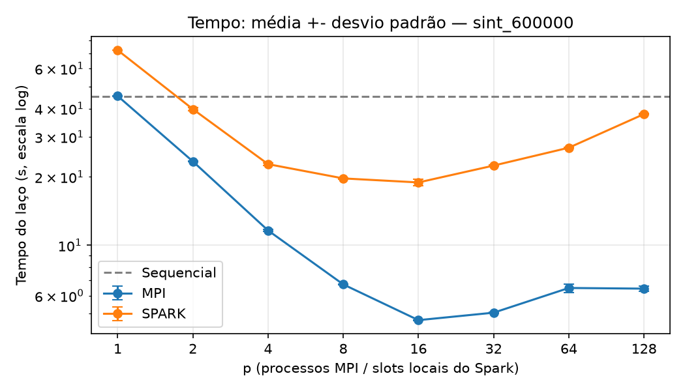
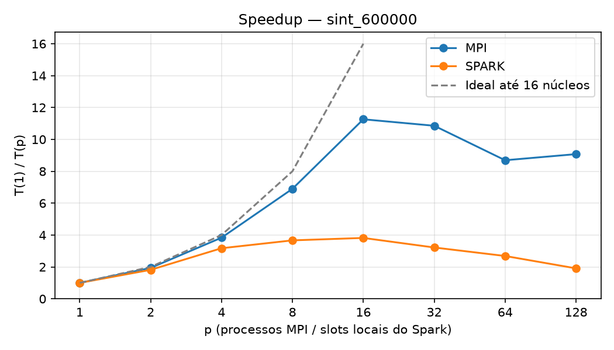
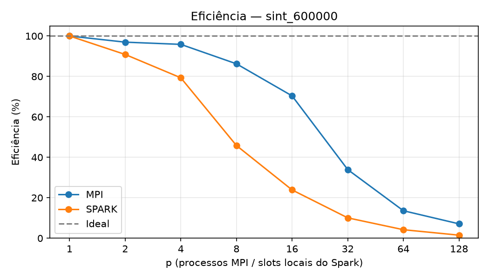
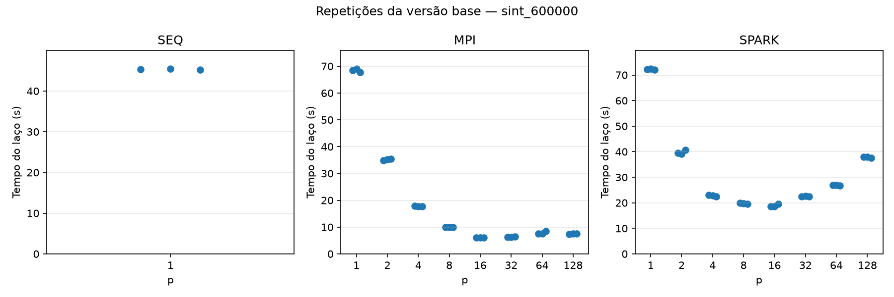
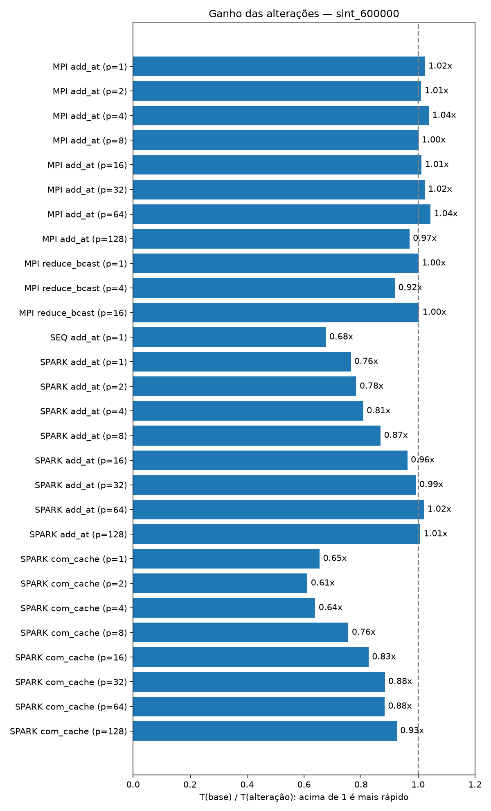
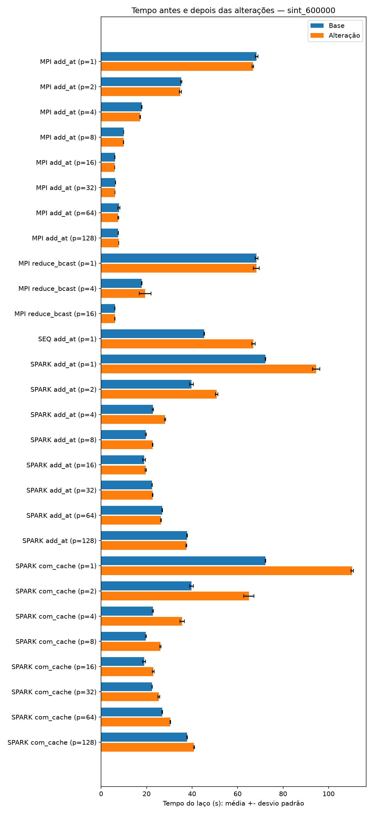

# Trabalho 2: K-Means Sequencial × Paralelo com MPI × Paralelo com Spark

Comparação, seguindo a metodologia de Saxena et al. (2020), *Comparison of MPI and Spark for Data Science Applications*, de três implementações em **Python** do algoritmo de Lloyd para a técnica de agrupamento de dados K-Means: uma sequencial, uma paralela utilizando **MPI (mpi4py)** e uma paralela utilizando a API de **RDDs** do **Spark (PySpark)**.

**AVISO SOBRE USO DE IA:** Foram utilizados serviços de inteligência artificial para geração de código e do README e para pesquisa e solução de dúvidas.

**Resumo dos resultados** (N = 600 mil, d = 256, k = 64, 20 iterações, 1 nó com 16 núcleos físicos):

- **MPI:** speedup de **9,7** com 16 processos (eficiência de 61%). Com 1 processo, o MPI leva o mesmo tempo que o sequencial puro (45,4 s contra 45,3 s).
- **Spark:** speedup de **3,8** com 16 núcleos (eficiência de 24%), praticamente parado a partir de p = 8.
- **O Spark foi de 1,6× (p = 1) a 4,0× (p = 16) mais lento que o MPI** com o mesmo número de núcleos.
- **Ambas as versões param de ganhar em p = 16**, o número de núcleos físicos do nó.
- **Validação:** as **165 execuções** usadas nas tabelas (sequencial, MPI, Spark e todas as variantes) terminaram com a **mesma inércia**, 88192.307179.

---

## 1. Aplicação e dados

- **Algoritmo:** K-Means de Lloyd com **número fixo de iterações (20)**, para que todas as versões façam exatamente o mesmo trabalho. Os centroides iniciais `C0` são sorteados com semente fixa e salvos em arquivo, então as três versões partem do mesmo ponto.
- **Atribuição:** é a etapa cara, O(N·k·d) por iteração. A distância é vetorizada com ‖x − c‖² = ‖x‖² − 2x·c + ‖c‖², em que o termo `X @ C.T` é um produto de matrizes (BLAS).
- **Atualização:** usa **somas e contagens** por cluster e só divide no fim. "Média de médias" estaria errada com grupos de tamanhos diferentes. As somas são feitas com uma matriz one-hot (`M.T @ X`, BLAS); a versão com `np.add.at` é uma das alterações (seção 7).
- **Cluster vazio:** mantém o centroide anterior.
- **Dados (`gera_dados.py`):**
  - k centroides não negativos mais ruído, com cada linha normalizada para norma 1. Com norma 1, a distância euclidiana equivale ao cosseno.
  - Matriz **densa, float64 e contígua**, salva em `.npy`. Os buffers das primitivas MPI em maiúscula exigem isso.
  - A geração é feita **uma única vez, fora das medições**. As três versões leem o mesmo arquivo.
  - No cluster, os dados foram gerados no próprio nó e conferidos pelas somas de X e de C0. Por exemplo, `sint_20000`: soma(X) = 226919.462829, soma(C0) = 722.818748.
- **Validação com texto real:** durante o desenvolvimento, as versões também foram validadas com o **20 Newsgroups** (TF-IDF com 20 mil termos → TruncatedSVD com d = 256 → norma 1; N = 18.278, k = 20). A inércia foi idêntica nas três versões, com max |C − C_seq| ≤ 5,6e-16. Esse modo foi removido do `gera_dados.py` para simplificar o código; a validação está registrada no commit `88d92bc`.

## 2. Implementação MPI (`kmeans_mpi.py`): primitivas e buffers

Usamos só as **variantes em maiúscula** (buffers numpy, sem pickle). Os tamanhos abaixo são para N = 600 mil, d = 256, k = 64:

| Primitiva | Dados | Tamanho | Quando |
|---|---|---|---|
| `Bcast` | dimensões N, d, k | 3 × int64 | 1× |
| **`Scatterv`** | linhas de X (N não precisa ser divisível por p) | N·d·8 = **1,23 GB** no total | 1× (`t_dist`) |
| **`Bcast`** | centroides iniciais C0 | k·d·8 = **128 KB** | 1× (`t_dist`) |
| **`Allreduce` (SUM)** | somas por cluster | k·d·8 = **128 KB** | **a cada iteração** |
| **`Allreduce` (SUM)** | contagens por cluster | k·8 = 512 B | a cada iteração |
| `Reduce` (MAX / SUM) | tempos / inércia | 4 e 1 doubles | 1×, fora do tempo |
| `Barrier` | delimita o cronômetro | — | — |

- **`Scatterv`:** os primeiros `N % p` processos recebem uma linha a mais. Os `counts` e `displs` são passados em **elementos** (linhas × d).
- **Depois do `Allreduce`, todos os processos têm as somas globais** e calculam os mesmos novos centroides. Por isso não há `Bcast` por iteração.

## 3. Implementação Spark (`kmeans_spark.py`): operações

- `sc.parallelize(range(P), P).map(carrega_bloco)`: cada partição carrega **o seu bloco** do `.npy` com `mmap` e calcula ‖x‖². Isso evita o limite de tamanho de tarefa do `parallelize`, mas exige o arquivo no mesmo caminho absoluto em todos os nós.
- **Sem `cache()` (padrão):** o RDD não é guardado na memória. A cada iteração, o Spark refaz o `map(carrega_bloco)`, ou seja, relê o bloco do `.npy` (que já está no cache de arquivos do sistema operacional) e recalcula ‖x‖². Guardar com `cache()` é uma das alterações (seção 7), e foi mais lento.
- **A cada iteração:**
  1. `sc.broadcast(C)`: os centroides vão para os executores;
  2. `mapPartitions(parcial)`: cada partição calcula somas e contagens com **as mesmas funções numpy** do MPI;
  3. `treeAggregate`: as somas parciais são combinadas em árvore e chegam ao **driver**, que calcula os novos centroides.
- **Diferença de modelo:** o Spark segue o padrão "Reduce + Bcast" centrado no driver; ele não tem um equivalente direto ao `Allreduce`.
- **Threads da BLAS = 1 também nos executores**, via `SparkConf.setExecutorEnv`: o `os.environ` do driver não chega até eles.

## 4. Ambiente experimental

| Item | Valor |
|---|---|
| Nó | **n-11** (o n-10 e o n-12 estavam inacessíveis: "No route to host") |
| CPU | 2× Intel Xeon E5-2680 @ 2,70 GHz: **16 núcleos físicos**, 32 threads |
| Memória | 31 GiB |
| Sistema | Ubuntu 24.04.3, kernel 6.8 |
| Software | Python 3.12.3, Open MPI 4.1.6, OpenJDK 21, mpi4py 4.1.2 (compilado contra o Open MPI do nó), numpy 2.5.4, PySpark 4.2.0 |
| Dados | `sint_600000`: N = 600.000, d = 256, k = 64 (X com 1,23 GB) |
| MPI | `mpiexec -n p`. p ≤ 16: 1 processo por núcleo físico; p = 32: `--use-hwthread-cpus`; p ≥ 64: `--oversubscribe` |
| Spark | modo `local[p]`: 1 JVM (driver = executor) com p núcleos, `spark.default.parallelism = p`, **partições = p**, `--driver-memory 8g` |

A máquina é compartilhada com a turma. Por isso, a carga do nó (`/proc/loadavg`) foi registrada antes de cada execução, nos arquivos `resultados/*.log`.

## 5. Metodologia de medição

- **O cronômetro cobre só o laço do K-Means.** A leitura inicial do disco fica fora.
- **`t_dist`** (distribuição inicial) é reportado à parte:
  - no MPI, é o `Scatterv` + `Bcast`;
  - no Spark, é o `count()` que força a primeira carga dos blocos pelos executores (leitura e ‖x‖²).
- **Diferença importante:** como o Spark roda **sem cache**, a releitura dos blocos e o ‖x‖² acontecem **de novo dentro do laço**, a cada iteração. No MPI, os dados ficam na memória de cada processo depois do `Scatterv`, e o ‖x‖² é calculado uma vez, dentro do laço. Mantivemos o Spark sem cache porque é a sua versão mais rápida (seção 7).
- **MPI:** `MPI.Wtime()` com `Barrier` antes e depois. O tempo reportado é o do processo mais lento (`Reduce MAX`).
  - `t_comp` e `t_comm` são medidos separadamente, e cada um também é o máximo entre os processos. Por isso eles não somam exatamente `t_total`.
  - O `t_comm` inclui a **espera por desbalanceamento**, porque o `Allreduce` sincroniza todos os processos.
- **Spark:** `time.perf_counter()` no driver. A subida da JVM fica fora. Não observamos efeito de aquecimento da JVM: as 3 repetições com p = 1 deram 72,26 s, 72,36 s e 72,05 s.
- **BLAS com 1 thread** em todas as versões: 1 processo = 1 núcleo de verdade.
- **3 repetições por configuração** nas versões base. Algumas variantes têm repetições a mais, porque a bateria foi interrompida e rodada de novo e as linhas se acumularam no CSV: seq `add_at` (5), Spark `add_at` (6 por p) e Spark com cache (6 em p = 1 e 4 em p = 2). As médias usam todas as execuções.
- As tabelas usam a média; a mediana e o desvio padrão estão em `resultados/resumo_sint_600000.csv`.
- **Speedup e eficiência:** S(p) = T(1)/T(p), com o T(1) **da própria versão**, e E(p) = S(p)/p. O "ganho sobre o seq" usa o sequencial puro em numpy.
- **Execução:** `rodar_bateria.sh` (CSV + log); **análise:** `analise.py` e `graficos.py` (tabelas e gráficos).
- Os CSVs medidos em 20/10 com uma versão anterior do código estão em `resultados/historico_2010/` e não entram nas tabelas.

## 6. Resultados

Tempo do laço, média de 3 repetições. **Sequencial puro em numpy: 45,31 s**, praticamente igual ao MPI com p = 1 (45,39 s). Ou seja, o MPI quase não acrescenta custo com 1 processo.

| p | MPI (s) | S | E | Spark (s) | S | E | Spark ÷ MPI |
|---|---|---|---|---|---|---|---|
| 1 | 45,39 | 1,00 | 100% | 72,22 | 1,00 | 100% | 1,59× |
| 2 | 23,40 | 1,94 | 97% | 39,74 | 1,82 | 91% | 1,70× |
| 4 | 11,62 | 3,91 | 98% | 22,76 | 3,17 | 79% | 1,96× |
| 8 | 6,73 | 6,75 | 84% | 19,70 | 3,67 | 46% | 2,93× |
| **16** | **4,68** | **9,69** | **61%** | **18,91** | **3,82** | **24%** | 4,04× |
| 32 (HT) | 5,05 | 8,99 | 28% | 22,44 | 3,22 | 10% | 4,44× |
| 64 (oversub) | 6,49 | 7,00 | 11% | 26,89 | 2,69 | 4% | 4,14× |
| 128 (oversub) | 6,45 | 7,04 | 6% | 37,81 | 1,91 | 1% | 5,87× |

| Tempo | Speedup | Eficiência |
|---|---|---|
|  |  |  |

**Fases do MPI** (média, s):

| p | 1 | 4 | 16 | 32 | 64 | 128 |
|---|---|---|---|---|---|---|
| `t_comp` | 44,85 | 11,47 | 4,52 | 4,79 | 5,82 | 5,64 |
| `t_comm` | 0,00 | 0,17 | 0,09 | 0,20 | 3,35 | 2,87 |

O `t_dist` do Spark varia de 2,3 s (p = 8) a 4,0 s (p = 128), contra 0,4 a 0,7 s do MPI.

**Repetições:** cada ponto do gráfico abaixo é uma execução da versão base.

**Interrompemos em 128, e a varredura além de 16 é só para registro:** como o enunciado permite, registramos os tempos de p = 32, 64 e 128 mesmo sem ganho.

## 7. As alterações de desempenho

Cada alteração é uma opção do programa. **O padrão é a versão mais rápida** (usada nas tabelas da seção 6); a opção é a versão "antes" da alteração. Todas foram medidas no mesmo nó, com as mesmas configurações.

| Alteração (antes → depois) | Versão | p = 1 | p = 4 | p = 16 |
|---|---|---|---|---|
| `np.add.at` → one-hot (`M.T @ X`) | Seq | 66,97 → 45,31 s (**1,48×**) | — | — |
| `np.add.at` → one-hot (`M.T @ X`) | MPI | 66,74 → 45,39 s (**1,47×**) | 17,18 → 11,62 s (1,48×) | 6,00 → 4,68 s (1,28×) |
| `np.add.at` → one-hot (`M.T @ X`) | Spark | 94,49 → 72,22 s (**1,31×**) | 28,18 → 22,76 s (1,24×) | 19,65 → 18,91 s (1,04×) |
| com `cache()` → sem cache | Spark | 110,36 → 72,22 s (**1,53×**) | 35,61 → 22,76 s (1,56×) | 22,88 → 18,91 s (1,21×) |
| 2 `Reduce` + 1 `Bcast` → 2 `Allreduce` | MPI | 45,58 → 45,39 s (1,00×) | 11,69 → 11,62 s (1,01×) | 4,68 → 4,68 s (1,00×) |

Entre parênteses: quantas vezes a versão "depois" é mais rápida, T(antes) / T(depois).

Os gráficos abaixo mostram a razão inversa, T(base) / T(antes), para todos os p. **Barras abaixo de 1 significam que a versão "antes" é mais lenta**, ou seja, que a alteração ajudou.

**Por que cada alteração mudou o tempo:**

1. **One-hot no lugar do `np.add.at`:** o `np.add.at` soma linha por linha, num laço interno do numpy, sem BLAS. Montando a matriz M (n × k), com M[i, j] = 1 se o ponto i está no cluster j, a soma de cada cluster vira um **produto de matrizes** (`M.T @ X`), que usa BLAS.
   - Com p = 1, a economia é **a mesma nas três versões**, em torno de 21 a 22 s (seq 21,7 s, MPI 21,3 s, Spark 22,3 s). Faz sentido: é a mesma conta numpy.
   - O ganho cai com p maior porque cada processo tem menos linhas e essa etapa pesa menos no total. No Spark ele cai mais rápido porque o tempo do Spark com p alto é dominado pelo overhead (seção 8).
2. **Sem cache no Spark:** no PySpark, `cache()` guarda os blocos **serializados (pickle) na JVM**. A cada iteração, eles voltam pelo socket JVM → Python e são desserializados. Sem cache, `map(carrega_bloco)` e `mapPartitions(parcial)` rodam **encadeados no mesmo processo Python**, e o `.npy` vem do cache de arquivos do sistema operacional (já na RAM). Refazer a leitura sai mais barato do que trazer o cache da JVM.
3. **Allreduce no lugar de Reduce + Bcast:** **sem ganho**. Num único nó, as coletivas passam pela memória compartilhada, e uma coletiva a mais quase não pesa. Num cluster com rede, a diferença deveria aparecer. Mantivemos a medição porque ela ilustra a escolha das primitivas.

## 8. Análise

**Onde o speedup satura:**
- **O MPI para em p = 16**, o número de núcleos físicos. A eficiência cai de 84% (p = 8) para 61% (p = 16), e a perda está no cálculo, não na comunicação: o `t_comm` com p = 16 é só 0,09 s, mas o `t_comp` é 4,52 s, contra 2,80 s de uma divisão perfeita (44,85 / 16). Hipóteses que não medimos: frequência de turbo menor com todos os núcleos ocupados e disputa pela banda de memória.
- **O Spark para em p = 8:** de 8 para 16 núcleos, o tempo quase não muda (19,70 → 18,91 s). Hipótese (não medida): a parte de cada iteração que não se divide entre os núcleos (broadcast, agendamento das tarefas, `treeAggregate` no driver) passa a dominar.
- **O hyperthreading (p = 32) não ajuda:** o produto de matrizes já ocupa as unidades de cálculo de cada núcleo, e duas threads no mesmo núcleo disputam essas unidades.
- **Com oversubscription, o MPI piora:** o `t_comm` sobe para ~3 s, porque o `Allreduce` espera processos que estão disputando o mesmo núcleo.

**Overhead do Spark:**
- Com 1 núcleo, o Spark é **1,59× mais lento** que o MPI fazendo **as mesmas contas numpy**. A diferença é overhead do caminho JVM ↔ Python a cada iteração: agendamento de tarefas, broadcast, `treeAggregate` e a releitura dos blocos.
- O Spark também **escala pior** (E16 = 24% contra 61%), e a razão Spark ÷ MPI cresce de 1,6× (p = 1) para 4,0× (p = 16).
- O `t_dist` do Spark é de 5 a 8× o do MPI.

**Complexidade do código:**

Os códigos das versões com MPI e com Spark têm tamanho parecido, mas cada um tem as suas complexidades particulares.

| | Sequencial | MPI | Spark |
|---|---|---|---|
| Linhas (total / sem comentários e linhas em branco) | 103 / 70 | 156 / 128 | 175 / 112 |

| | MPI | Spark |
|---|---|---|
| O que o programa controla | **quase tudo**: separação manual das tarefas da raiz (`rank = 0`) das dos outros processos (todos rodam o mesmo código); buffers separados para distribuição e agregação; `counts` e `displs` do `Scatterv`; cronômetro por fase com `Barrier` | particionamento, agendamento, tolerância a falhas e coleta dos resultados ficam com o Spark; com outra abordagem, o código poderia ser ainda mais simples |
| Armadilhas que encontramos | ordem obrigatória das coletivas (uma coletiva dentro de `if rank == 0` trava todos); tipo do buffer de recebimento (as contagens viram `float64` para casar com `MPI.DOUBLE`) | **complexidade escondida**: limite de tamanho de tarefa no `parallelize`; variáveis de ambiente que não chegam aos executores; caminho absoluto do `.npy`; avaliação preguiçosa (*lazy evaluation*); o `cache()` que piorou o tempo; **erros de falta de memória na JVM**, que exigiram aumentar a memória do driver |
| Depuração | um erro em um processo deixa os outros parados esperando na próxima coletiva | stack traces da JVM misturadas com as do Python |

- **O MPI foi mais rápido e escalou melhor, à custa de mais trabalho explícito. O Spark esconde a distribuição, mas cobra em desempenho e em armadilhas menos visíveis.** É a mesma conclusão de Saxena et al. (2020).

**Limitações:**
- **Um único nó.** Toda a comunicação foi intra-nó, o que a torna mais barata do que num cluster com rede.
- **Spark em modo local** (`local[p]`): driver e executor na mesma JVM.
- **Máquina compartilhada:** o cluster é da universidade, e é possível que outras pessoas o tenham usado durante os testes. A carga está registrada nos logs.

## Conclusão

Para o K-Means com numpy em um nó com 16 núcleos:
- **O MPI foi de 1,6× a 4,0× mais rápido que o Spark** (p = 1 a 16) e chegou a um speedup de 9,7, contra 3,8.
- **A diferença vem do overhead do PySpark,** não das contas, que são idênticas: com mais núcleos, a parte fixa de cada iteração (JVM ↔ Python, agendamento, agregação no driver) passa a pesar mais do que o próprio cálculo.
- **As alterações mais eficazes:** o produto de matrizes no lugar do `np.add.at` (1,47× no MPI e 1,31× no Spark com p = 1) e não usar o cache serializado do PySpark (1,53× com p = 1).

## Teste rápido (variável SMOKE)

Exemplo: `SMOKE=1 ./rodar_bateria.sh mpi sint_20000` (p = 1 e 2, 1 repetição). A inércia esperada é 3460.713486. Antes, gere os dados com `python gera_dados.py --N 20000` e rode `python kmeans_seq.py --nome sint_20000` (gabarito da validação).

**Referência:** M. Saxena, S. Jha, S. Khan, J. Rodgers, P. Lindner e E. Gabriel, *Comparison of MPI and Spark for Data Science Applications*, IEEE IPDPSW, 2020.
